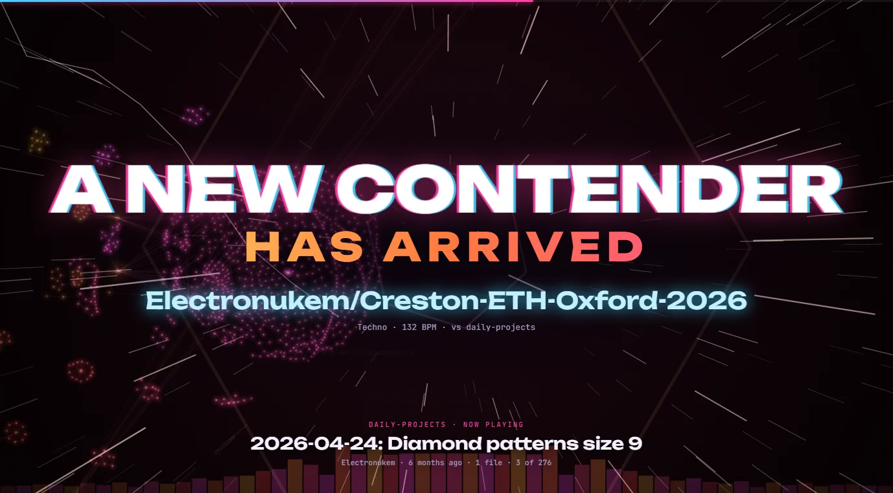
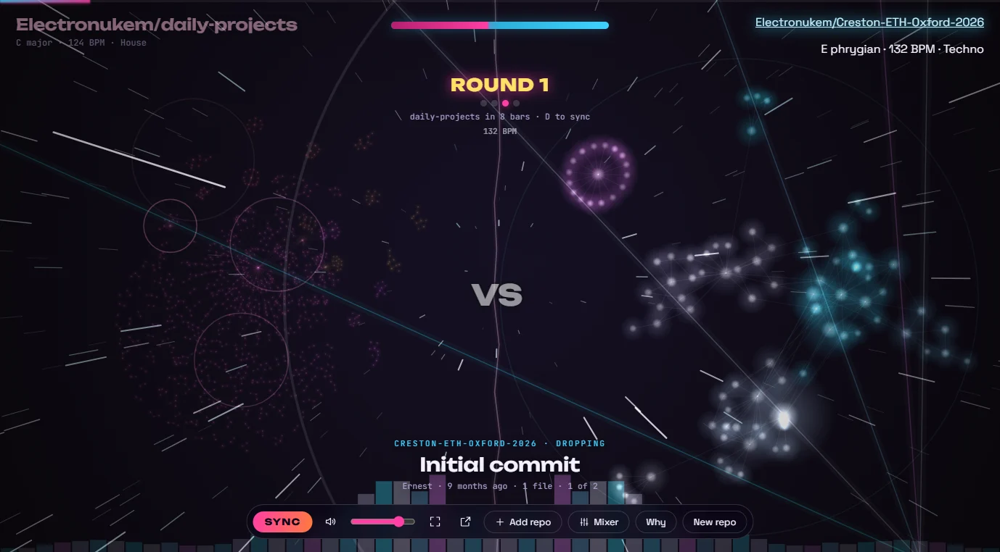
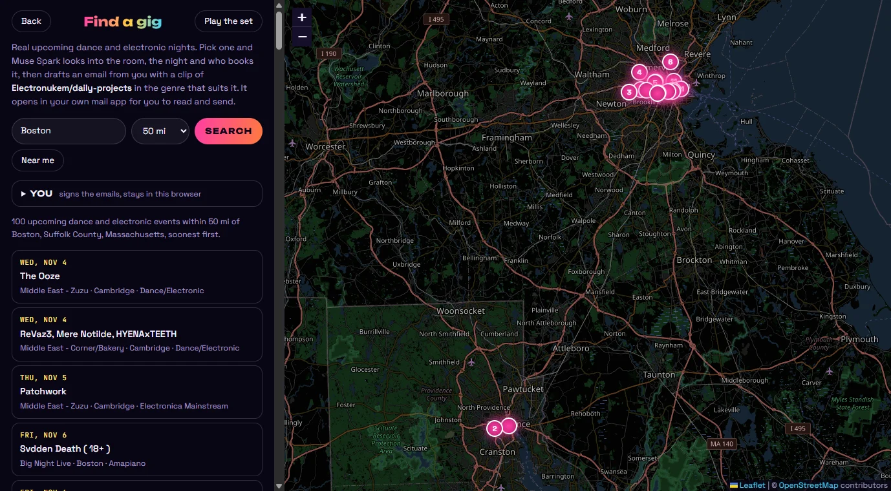
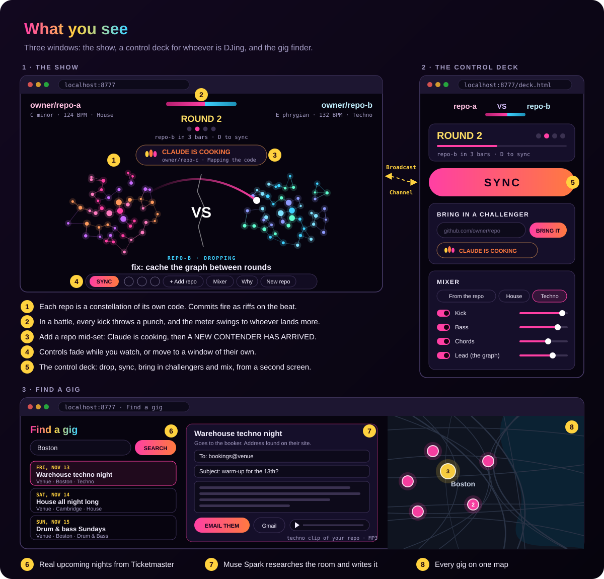
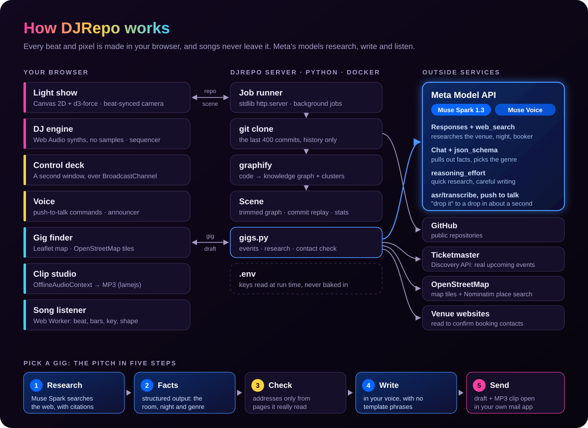

<div align="center">

# DJRepo

**Your GitHub repo, played as a live EDM set with a light show.**<br>
Battle two repos, or your code against a song. Bring in challengers mid-set. Then let Meta's Muse Spark find you a real gig.




</div>

## Try it in one command

```sh
docker compose up --build
```

Open **http://localhost:8777**, paste a public repo (try `Electronukem/daily-projects`), and press
**Drop it**. Turn it up. The set and the light show need no keys. The gig finder needs two
([Keys](#keys)).

## The 60-second tour

1. **Drop it.** [graphify](https://github.com/Graphify-Labs/graphify) maps the repo's code into a
   constellation, and its history picks the genre, key and tempo. Commits fire as riffs on the beat
   while the camera slams in and out with the kick.
2. **Battle.** Two repos take eight-bar rounds in their own genres and throw punches on every kick.
   Press **D** and they sync up: they trade bars, their tempos meet, and they land in one mashup drop.
3. **Battle a song.** Drop in an MP3 instead of a second repo, and your code fights it. DJRepo
   listens to the song in your browser, finds its tempo, bars and key, and draws it as a graph of its
   own: every beat a star, sounds that match in the same colour, and repeats linked together.
4. **A new contender.** Press **A** mid-set and paste another repo, or drop in a song. The music never
   stops: *"Meta is cooking"* while it loads, then the room builds up, a title card slams in, and the
   newcomer crashes onto the stage on the drop. Winner stays on.
5. **The control deck.** Press **C** to move every control to a second window, so the show stays
   full screen and clean on the big screen while you DJ from your laptop.
6. **Find a gig.** Real upcoming dance and electronic nights on a map (it opens on Boston). Pick one
   and **Muse Spark** researches the room, the night and who books it, then drafts a booking email
   in your voice with a clip of your set attached.

<table>
  <tr>
    <td width="50%"></td>
    <td width="50%"></td>
  </tr>
  <tr>
    <td align="center"><b>Battle a song:</b> every beat of it is a star</td>
    <td align="center"><b>Find a gig:</b> real nights around Boston</td>
  </tr>
</table>

## What you see



## Built with Meta

The gig finder runs on **Muse Spark** (`muse-spark-1.3`) through the
[Meta Model API](https://dev.meta.ai). Every step uses a different part of the platform:

| Step | Meta Model API | What it does |
| --- | --- | --- |
| **Research** | Responses API + `web_search` (search grounding), `reasoning.effort: low` | Looks into the venue, the night, the promoter and how they take bookings, with citations |
| **Facts** | Chat Completions + strict `json_schema` | Pulls out the room, the night, a current detail a regular would know, the booking contact and the genre that fits |
| **Write** | Chat Completions, `reasoning_effort: medium` | Writes 70–130 words in the DJ's own voice, then rewrites once if any template phrase slips in |

Then DJRepo renders a clip of your repo's set in the genre Muse Spark picked (a four-bar build-up
into a sixteen-bar drop, MP3), and **Email them** opens the draft in your own mail app with the clip
saved to attach.

**Honest by design.** A booking address is only used if it's really on a page DJRepo read. When
fabric's FAQ listed `events@` for *private hire*, it was ruled out. Names are only used if a source
names them. Claims about the DJ come only from their profile. If a venue says how it takes demos,
the draft follows it. Nothing is ever sent for you: you read it, attach the clip, and press send.

## How it works



Everything musical happens in the browser: there are no samples, and every kick, chord and riser is
synthesised with Web Audio. The Python server clones the repo, runs graphify, and hands the browser
a compact *scene*: the trimmed graph, the commit history to replay, and stats about how the code was
written.

### How the repository picks the music

| From the repository | Becomes |
| --- | --- |
| Commits per week | 35 or more is **drum & bass**; otherwise it sets the tempo within the genre's range |
| Time of day of the commits | Mostly after dark (9pm–6am) is **techno**. Daytime work is in a major key, later work in minor |
| Main language | Web code (JS/TS/CSS…) is **big room**, systems code (C, Rust, Go, Java…) is **trance**, everything else is **house** |
| Main language | The lead synth: FM bell (Python and similar), pluck (web), supersaw (systems), 8-bit (anything else) |
| Size of the graph | How long the reverb rings |
| How connected the code is | How often light leaps between nodes |
| Repository name | Key and chord progression |

Every commit fires as a riff: the code it touched plays in the genre's hook rhythm, its names
glitch onto the screen, and the commit message shows as *Now playing*. Between commits, light
travels along the graph's edges and plays the lead as it lands. Each cluster's colour picks the
note, its height on screen the octave, and left to right is where you hear it. **Why** in the
controls lists the reasons for the repo on screen.

<details>
<summary><b>The set, phrase by phrase</b></summary>

The set runs in phrases: an intro, then a loop of groove → build-up → drop → breakdown → build-up →
drop. Each phrase is eight bars, and drops are sixteen.

- **Intro.** Kick and hats with the filter slowly opening; the camera creeps in.
- **Groove.** The full beat with the chords filtered down. A commit drops every other bar.
- **Build-up.** A snare roll that speeds from quarters to sixteenths, a noise riser, a rising high-pass
  filter, and lasers starting to sweep. The kick drops out, then one beat of silence: the screen goes
  dark and the camera is pushed all the way in.
- **Drop.** An impact and a white flash, the camera smash-cuts out, and everything plays. Every kick
  punches the camera in, shockwaves ring out, and lasers fan up from the floor. The camera alternates
  bar by bar between a wide shot and a close-up of the code the latest commit touched.
- **Breakdown.** No drums. Pads swell, the camera drifts back out, and the stars slow to a crawl.

</details>

<details>
<summary><b>Battles, syncs and the mashup drop</b></summary>

With two repos, each is a deck with its own genre, key and tempo, and its graph takes a corner.

- **Rounds.** Eight bars each, in each deck's own genre and tempo: house at 125 against drum & bass at
  176, say. The deck that's playing leans in; the other backs off and dims.
- **Punches.** Every kick and clap throws a comet at the other graph and knocks it back. The meter at
  the top swings toward whoever is landing more.
- **Sync (D).** The decks trade a bar each, then half bars, beats and eighth notes, while their tempos
  glide to meet and the second deck moves into the first deck's key. The graphs circle in.
- **One drop.** The graphs spiral together and land as one double constellation in a sixteen-bar
  mashup drop: drums from one repo, bass and chords from the other (pick who brings what under
  **Mashup** in the mixer). Lightning jumps between them on every kick.

</details>

<details>
<summary><b>Battling a song</b></summary>

Pick **♪ or a song** next to the second repo box, or drop an audio file anywhere on the page (MP3,
WAV, M4A, OGG or FLAC). It's decoded and listened to in a Web Worker in your browser, and never
uploaded.

- **Listening.** The listener finds the onsets, then the tempo (and checks it isn't an echo or
  half-time in disguise), then fits a beat grid to the whole song so it doesn't drift. Bars start
  where the harmony changes, and the key comes from the song's pitch profile.
- **Its graph.** Every beat is a star. Beats that sound alike (harmony and timbre, over a bar)
  cluster into "sounds", each with its own colour, and passages that come back link to where they
  were heard before, so the song's shape pulls together.
- **In the battle.** The song plays as it is: never stretched, never re-pitched. It comes in at its
  most intense stretch, and each bar of the recording lands on DJRepo's bar grid. Its own beats throw
  the punches, and the caption shows where you are in it.
- **Together.** Press **D** and the repo comes to the song's tempo and key. They trade turns, chopped
  down to eighth notes, and then drop together: the song with the repo's drums on top and its graph
  on lead.

A new song added mid-set takes over from a song that's already playing, so it's always code against
a song.

</details>

<details>
<summary><b>A new contender, step by step</b></summary>

- While the repo loads, the set carries on, and a banner and the announcer say **"Meta is cooking"**.
  The new graph's layout is settled a few milliseconds at a time, so the music never stutters.
- When it's ready, the deck that stays builds up for four bars under a full-screen **A NEW CONTENDER
  HAS ARRIVED** card, with the music dipping under the voice. The name is revealed halfway through.
- On the drop the screen flashes white and the newcomer flies in huge from its side of the stage and
  takes round one. A solo set becomes a battle. In a battle, whoever is behind on the meter is knocked
  out and spins away.

The voice is the browser's own speech (Edge's "Natural" voices sound best). Switch it off under
**Announcer** in the mixer.

</details>

<details>
<summary><b>The mixer</b></summary>

- **Genre** from your repo, or house, techno, trance, big room or drum & bass, per deck.
- **Mashup**: which repo brings the drums, the bass, and the chords to the drop you make together.
- **Lead synth**: pluck, supersaw, FM bell, 8-bit or acid.
- **Channels**: kick, clap & snare, hi-hats, percussion, bass, chords, pad, arpeggio, the lead, and
  risers & impacts, each with a switch and a level. Everything melodic pumps under the kick.
- **Visuals**: camera intensity and flashing lights. **Announcer**: the voice on or off.

</details>

## Controls

| Key | Does |
| --- | --- |
| **D** | Skip to the next drop. In a battle: sync the decks into one drop |
| **A** | Bring in another repo, or a song, while the set plays |
| **C** | Put the controls in a window of their own |
| **X** | Mixer |
| **F** | Full screen |
| **M** | Mute |

**Contains flashing lights** when a drop lands. Switch them off on the start screen or in the mixer.
If your system asks for reduced motion, they start off, and the camera moves far less.

## Keys

The set and the light show need no keys. The gig finder needs two, in a `.env` file next to
`server.py` (copy [`.env.example`](.env.example)):

| Key | What for | Where |
| --- | --- | --- |
| `TICKETMASTER_API_KEY` | Real upcoming events | Free, at [developer.ticketmaster.com](https://developer.ticketmaster.com) (Discovery API) |
| `MODEL_API_KEY` | Muse Spark research and writing | [dev.meta.ai](https://dev.meta.ai) |

Docker Compose reads `.env` when the container starts; keys are never copied into the image. A draft
takes two or three minutes (most of it is the web search), and starts the moment you pick a gig, so
it's usually ready by the time you've read about the night. Muse Spark is billed pay-as-you-go by Meta:
each email is three calls, or four if the writing needs a second pass.

## Run without Docker

You need Python 3.11+ and git.

- **Windows:** double-click `start.bat`.
- **macOS or Linux:** run `./start.sh`.

The first run creates a `.venv` and installs graphify into it (the PyPI name is `graphifyy`, with two
y's), which takes a minute. A browser tab opens at http://127.0.0.1:8777. Options:
`server.py --port 9000 --max-nodes 800 --host 127.0.0.1 --no-browser`

## What's where

| File | What it is |
| --- | --- |
| [`server.py`](server.py) | The local server: clones the repo, runs graphify, builds the scene, and serves the API |
| [`gigs.py`](gigs.py) | The gig finder: Ticketmaster events, Muse Spark research and writing, contact checking |
| [`common.py`](common.py) | Background jobs, subprocesses, and trimming a graph down to a scene |
| [`web/app.js`](web/app.js) | The light show, the HUD, a new contender's entrance, and the link to the control deck |
| [`web/dj.js`](web/dj.js) | The DJ: a Web Audio sequencer and every synth, drum and effect |
| [`web/genres.js`](web/genres.js) | The five genres: tempos, patterns and colours |
| [`web/deck.html`](web/deck.html), [`web/deck.js`](web/deck.js) | The control deck window |
| [`web/gigs.js`](web/gigs.js), [`web/sample.js`](web/sample.js) | The gig finder screen, and the offline clip renderer |
| [`web/song.js`](web/song.js), [`web/song-worker.js`](web/song-worker.js) | A song as a deck: decoding it, and the listener that finds its beat, key and shape |
| [`Dockerfile`](Dockerfile), [`docker-compose.yml`](docker-compose.yml) | One-command setup |

## Notes

- Only public repositories work, because nothing asks for GitHub credentials.
- Songs stay in your browser. The listener works best on music with a steady beat and a clear kick.
- Results are cached in `.cache/` (a Docker volume, in Docker), so anything you've played before
  opens instantly from the chips on the start screen.
- Very large graphs are trimmed to their 1,500 most connected nodes, and 900 each in a battle.
- The page loads d3, Leaflet and lamejs from cdnjs, map tiles and place search from OpenStreetMap,
  and fonts from Google Fonts, so it needs an internet connection.
- The server listens only on this machine (127.0.0.1). The Docker setup publishes it to localhost only.

## License

[MIT](LICENSE). Remix it.
